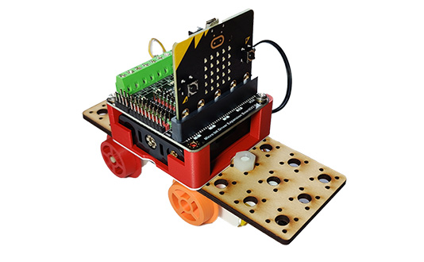

# Project 2.01 - Build a Train

{ align=right }

In this project you will make and code a basic train.

In this project you will create a simple train engine, powered by a single motor.

In subsequent projects you will be able to extend this train, adding lights, sensors and signalling.

## Worksheets

[Student Worksheet](Project 2.01 - Build a Train.pdf){ target=_blank }

