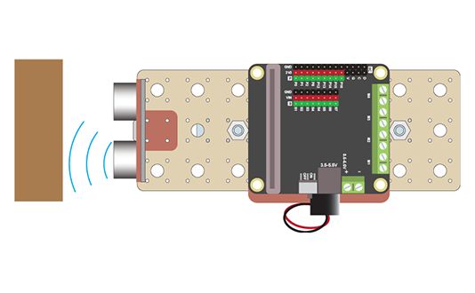

# Project 2.04 - Add an Ultrasonic Sensor to your Train

{ align=right }

In this project you will make a train that moves forward on the track until it sees the end of the track.

You will attach an ultrasonic sensor to the front of your train. This can detect the distance to the nearest obstacle. You will then write some code to use this information to stop the train when it sees a wall at the endo of the track.

## Worksheets

[Student Worksheet](Project 2.04 - Add an Ultrasonic Sensor to your Train.pdf){ target=_blank }

## Code Solutions

[Challenge solution: Slow and stop](code/microbit-microbit-challenge-solution-slow-and-stop.hex)

[Ultrasonics crash sensor](code/microbit-microbit-challenge-solution-ultrasonics-crash-sensor.hex)

