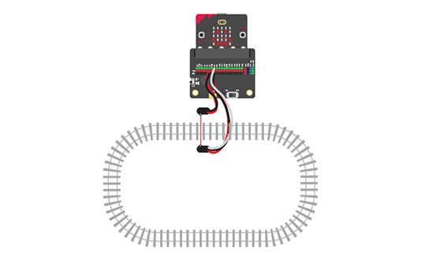

# 2.05 - Build a Signalling System for Trains

{ align=right }

In this project you will create a signalling system that can automatically control trains on complex track systems.

You will attach a break-beam sensor to the track. This will detect when a train has entered a particular part of the track so that multiple trains can be controlled to safely move along the track.

## Worksheets

[Student Worksheet](Project 2.05 - Build a Signalling System for Trains.pdf){ target=_blank }

## Code Solutions

[Train A](code/microbit-train-signalling-trainA.hex)

[Train B](code/microbit-train-signalling-trainB.hex)

[Controller one train](code/microbit-train-controller-single-train.hex)

[Controller two trains](code/microbit-train-controller-two-trains.hex)

[Controller two trains auto](code/microbit-train-controller-two-trains-auto.hex)