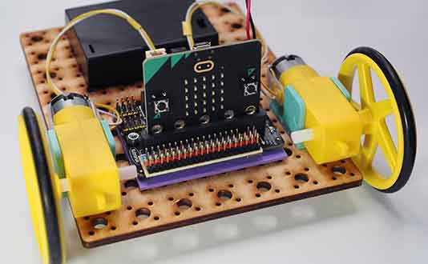

# Project 1.01 - Build a Basic Robot

{ align=right }

In this project you will make and code a basic wheeled robot.
Wheeled robots are a fun way to get started in digital making. In this project you will create a simple 3-wheeled robot and use block-based coding to get it to make specific movements.

In subsequent projects you will be able to extend this robot, adding lights, sensors and a remote control.

## Worksheets

[Student Worksheet](Project 1.01 - Build a Basic Robot.pdf){ target=_blank }

## Code Solutions

[Basic robot movements](code/microbit-basic-robot.hex)

[Challenge solution: Move backwards](code/microbit-challenge-solution-basic-robot-move_backwards.hex)

[Challenge solution: Square](code/microbit-challenge-solution-basic-robot-square.hex)

[Challenge solution: Dance](code/microbit-challenge-solution-basic-robot-dance.hex)

