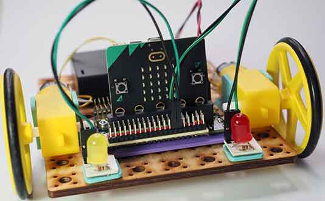

# Project 1.02 - Add Lights to your Robot

{ align=right }

In this project you will add lights to the robot you previously made.

Adding lights will extend your digital making skills by teaching you about digital outputs and LEDs.

## Worksheets

[Student Worksheet](Project 1.02 - Add Lights to your Robot.pdf){ target=_blank }

## Code Solutions

[Two LEDs](code/microbit-two-leds.hex)

[Challenge solution: Third LED](code/microbit-challenge-solution-third-led.hex)

[Challenge solution: Indicators](code/microbit-challenge-solution-indicators.hex)

[Challenge solution: Siren](code/microbit-challenge-solutiuon-siren.hex)