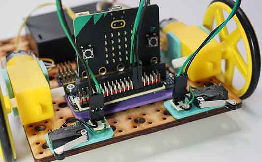

# Project 1.04 - Build a Remote Control Robot

{ align=right }

In this workshop you will make a remote controller which can be used to control the robot you built in a previous workshop.

For the remote control you will need another Microbit. So you will have two Microbits, one in the controller and one in the robot. We will use the radio feature of the Microbit to send messages from the controller to the robot.

## Worksheets

[Student Worksheet for Robot](Project 1.04 - Build a Remote Control Robot.pdf){ target=_blank }

Note that coding the controller can be challenging for students.  Consider providing a pre-coded Microbit for the controller and leaving the student to code the robot.  Make sure you give each student a controller set to a different radio group so they all control their own robots.  To do this, open up the controller solution code below in Makecode, change the radio group and download it to the controller Microbit.

[Student Worksheet for Controller](Project 1.04 - Build a Remote Control Robot - Controller.pdf){ target=_blank }

## Code Solutions

These solutions use radio channel 9.  Change the radio channel for your robot so it is unique in the classroom.

[Challenge solution: Robot](code/microbit-challenge-solution-robot.hex)

[Challenge solution: Controller](code/microbit-challenge-solution-controller.hex)

