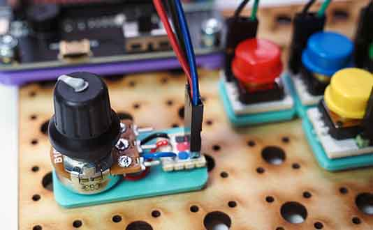

# Project 1.05 - Add a Speed Control to your Remote

{ align=right }

In this project you will add a speed control to your remote controller.

For the speed control you will add a potentiometer to the remote control. This is an analogue input device. By turning the knob, you can get different values from 0 to 100 which can be used to set the speed. When we read the value from the potentiometer on the controller, we need to send the value across to the robot, so it can adjust its speed.

## Worksheets

[Student Worksheet](Project 1.05 - Add a Speed Control to your Remote.pdf){ target=_blank }

## Code Solutions

These solutions use radio channel 9.  Change the radio channel for your robot so it is unique in the classroom.

[Code solution: Robot](code/microbit-robot.hex)

[Code solution: Controller](code/microbit-controller.hex)