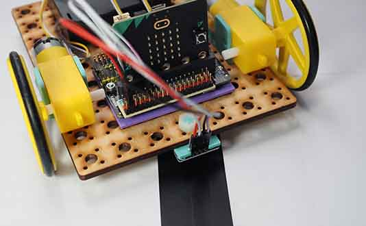

# Project 1.06 - Build a Line Following Robot

{ align=right }

In this project you will make robot that can follow a black line on the floor.

You will attach a line following sensor to the underside of your robot. You will then write some code that uses the line sensor to detect when the robot is on the line.

## Worksheets

[Student Worksheet](Project 1.06 - Build a Line Following Robot.pdf){ target=_blank }

## Code Solutions

[Line follower](code/microbit-line-follower-robot.hex)

This version includes improvements to make it better at finding the line again when it loses it.

[Improved line follower](code/microbit-line-follower-robot-improved.hex)

