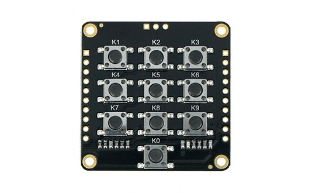
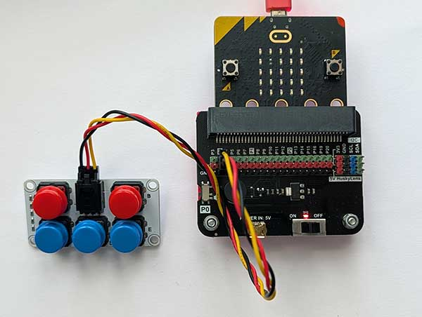
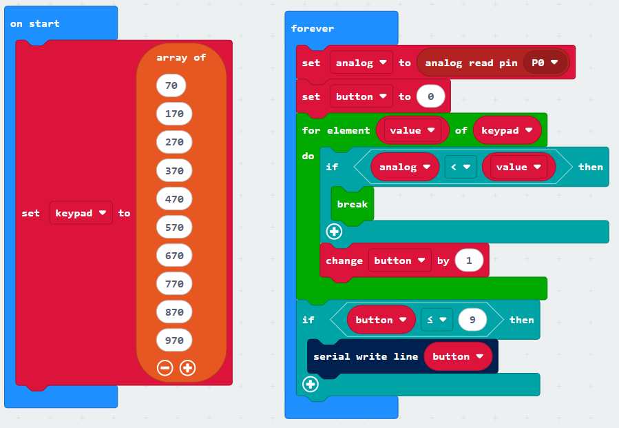
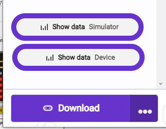

When you need lots of buttons in your project, you can soon run out of digital pins.

The 10-button ADKeypad gives you access to 10 buttons on a single **analogue** pin.

## Wiring
Use a GVS cable to connect the ADKeypad connector to an analogue pin.  The GVS cable has 3 wires, blue, red and black:

{ width=400 }

Connect up as follows, using the Edge Connector or Motor Controller board:

|AdKeypad   | Microbit             |
| :-------------- | :------------------  |
|3-pin connector  | P0 3-pin connector   |

Connect the blue wire to the S pin on the ADKeypad and the blue wire to the green pin on the Edge Connector or Motor Controller.  Alternatively use the black/red/yellow cable supplied with the ADKeypad and connect the yellow pin to the green pin on the Edge Connector or Motor Controller:

{ width=600 }

You don't have to use pin P0.  You can use any <a href="../../../assets/pins-short.png" target="_blank">analogue pin</a>.  Just remember to adjust your code accordingly.

## Coding

Enter this code:

The Serial blocks can be found in Advanced.

Download the code to the microbit.

To see the data, click on Show data Device:

Press each button in turn.  You should see the button number appear.

## How it Works
When no button is pressed, the ADkeypad returns a value of approximately 1023. The numbers in the keypad array correspond to the maximum analogue values that are returned for each button.  The code loops through these values, returning the position of the first value which is lower than the analogue value read by the pin.  The value of the **button** variable will end up being the number of the button that was pressed.

## Project Idea
Create a calculator, or a pin entry for a door.

 
