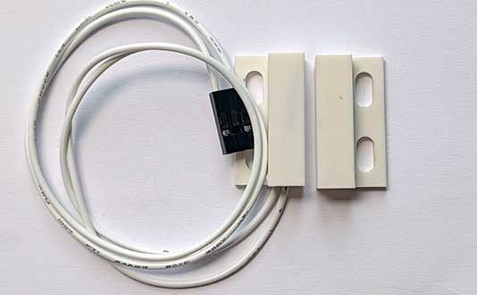
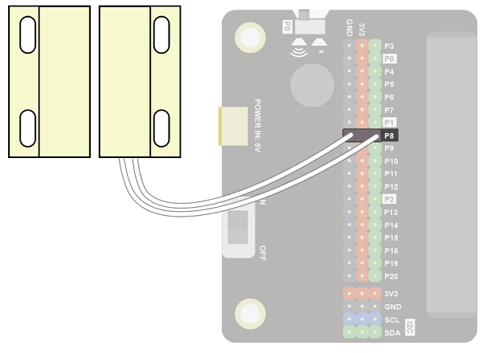
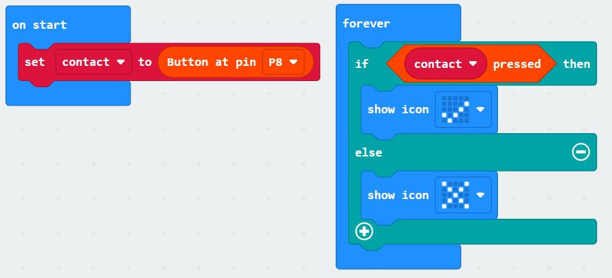
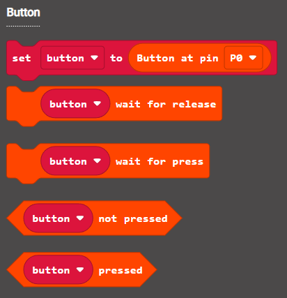

A contact switch is essentially a digital input controlled by a magnet.  There are two parts.  The part with wires is the digital input.  The other contains the magnet.  When the magnet is brought close to the digital input part, the state of the digital input changes.

Use a contact switch to detect when someone opens or closes a door.

## Wiring
The contact switch comes with wires attached.

Wire up as follows, using the Edge Connector or Motor Controller board:

|Contact switch   | Microbit             |
| :-------------- | :------------------  |
|3-pin connector  | P8 3-pin connector   |

{ width=600 }

You don't have to use pin P8.  You can use any <a href="../../../assets/pins-short.png" target="_blank">digital pin</a>.  Just remember to adjust your code accordingly.

## Coding

Enter this code:

The block **set pull pin P8 to up** ensures the default state of the pin is the value 1.  When the contact is made by the magnet, the value of the pin goes to 0. 

Download the code to the microbit.

The display should show an X.  When you pbring the magnet close to the switch it should show a tick.

## Coding with the Bitmake extension
The bitmake extension makes it a bit easier to work with buttons and other basic devices.

To add the extension, first click on Extensions:

Then enter the URL for the extension:

Then click on the extension:

You should see the following block:

Enter the following code:

Download the code to the microbit.

It will work in the same way as the previous code.  The benefit of using the extension is that controlling multiple digital inputs is neater.  

There are a number of code blocks in the Bitmake extension that can help you in your projects:

