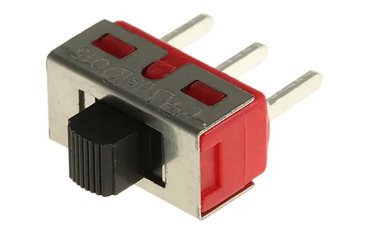
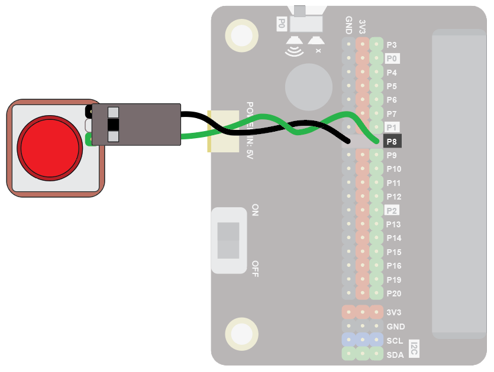
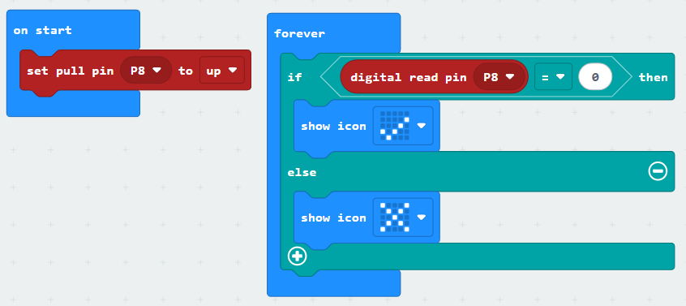
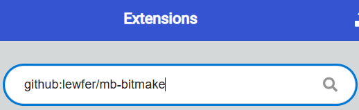
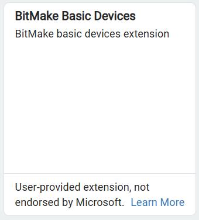
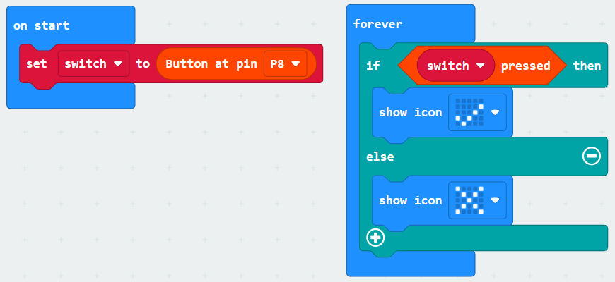

An on/off switch provides a digital input.  They behave in exactly the same way as a button, reading 1 or 0, but they stay in the selected state (whereas a button returns to the off state when you release it).

Use on/off switches to turn things on or off!

## Wiring
Use a GS cable to connect the switch.  This has 2 wires, green and black:

{ width=400 }

Wire up as follows, using the Edge Connector or Motor Controller board:

|Switch   | Microbit             |
| :-------------- | :------------------  |
|3-pin connector  | P8 3-pin connector   |

{ width=600 }

You don't have to use pin P8.  You can use any <a href="../../../assets/pins-short.png" target="_blank">digital pin</a>.  Just remember to adjust your code accordingly.

## Coding

Enter this code:

The block **set pull pin P8 to up** ensures the default state of the pin is the value 1.  

Download the code to the microbit.

Depending on the position of the switch, it should show a tick or a cross.

## Coding with the Bitmake extension
The bitmake extension makes it a bit easier to work with switches and other basic devices.

To add the extension, first click on Extensions:

Then enter the URL for the extension:

Then click on the extension:

You should see the following block:

Enter the following code:

Download the code to the microbit.

It will work in the same way as the previous code.  The benefit of using the extension is that controlling multiple switches is neater.  

There are a number of code blocks in the Bitmake extension that can help you in your projects:

