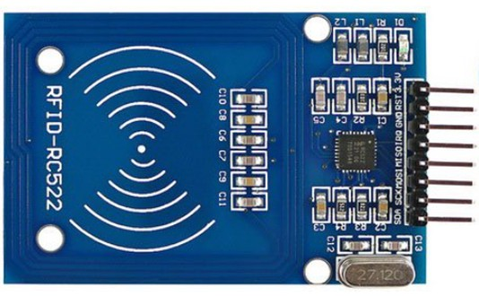
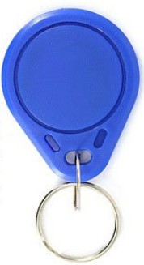
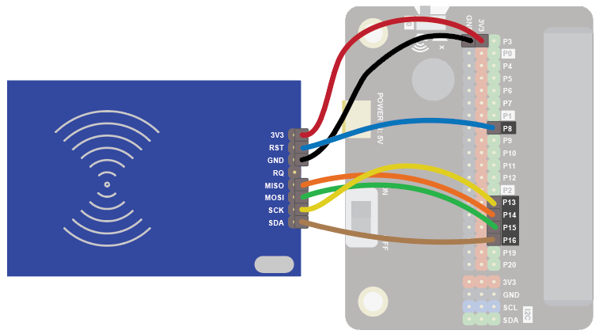
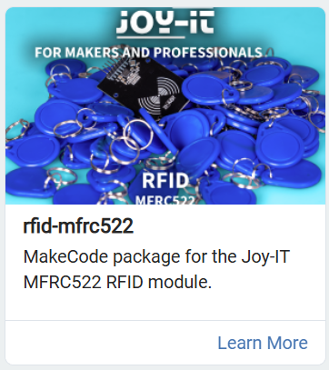
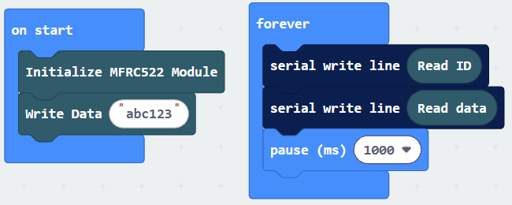
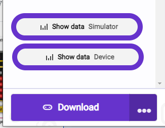
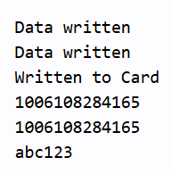

A RFID reader can be used to read and write to various RFID cards and tags, each of which has a code and some optional data.  The code is unique and can't be changed, but a small amount of data can be written to the card and read.

Use it to identify someone or something, for example to give cardholders access to a door, or tag and scan products.

This is an example of an RFID tag.

## Wiring
Connect FF wires to the Edge Connector or Motor Controller board as follows:

| RFID              | Microbit            | 
| :---------------- | :------------------ | 
| VCC               | 3V3                 |   
| RST               | P8                  |   
| GND               | GND                 | 
| MISO              | P14                 | 
| MOSI              | P15                 | 
| SCK               | P13                 | 
| SDA               | P16                 | 

{width = 600}

## Coding
We need to add and extension to get the RFID reader to work.

Click on the extensions block:

Then search for "rfid" and click on the **rfid-mfrc5222** extension:

Enter this code:

[Download code to your computer](code/microbit-rfid.hex)

The Serial blocks can be found in Advanced.

Download the code to the microbit.

To see the data, click on Show data Device:

You should see some numbers, which represent the RFID tag ID and the data stored on the tag.

 