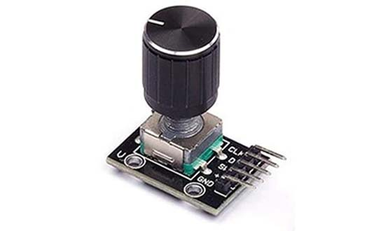
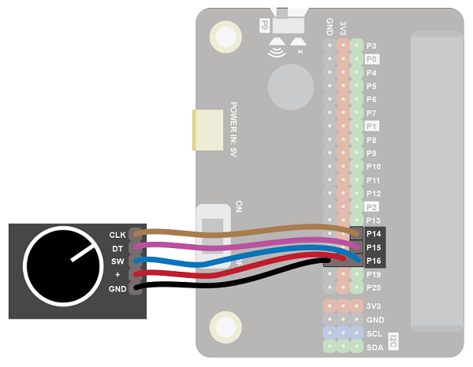
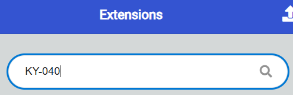
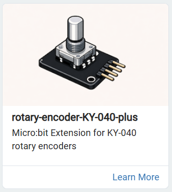
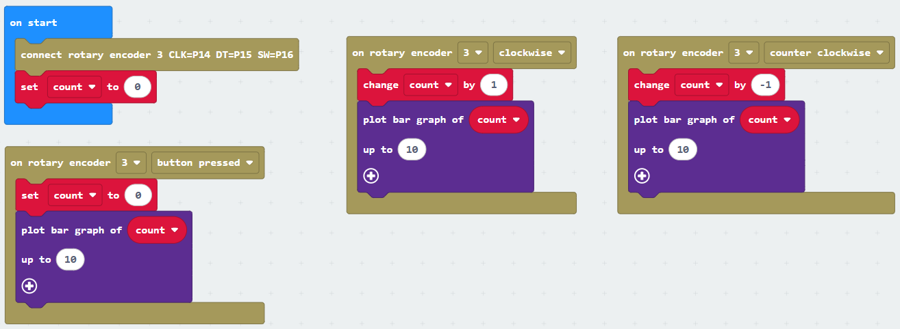

The rotary encoder senses movement of the knob in either direction.

Use it to scroll through menus or control values such as volume.

## Wiring
Use the a GVS cable and two F-F single wires to connect the sensor.  The GVS cable has 3 wires, blue, red and black:

Wire up as follows, using the Edge Connector or Motor Controller board:

|Rotary encoder    | Microbit       ||
| :--------------- | :------------- ||
|GND,+,SW          | Pin 16         | Connect the blue wire to SW on the rotary encoder |
|DT                | Pin 15         ||
|CLK               | Pin 14         ||

This is what it should look like on the edge connector:

## Coding

You will need to add an extension to get additional blocks for the display.  Click on the extensions block:

Then search for "ky-040":

Then click on the **rotary encoder KY-040-plus** extension:

You should see a new block appear:

Enter this code:

Download the code to the microbit.

Turn the knob on the rotary encoder.  The bar graph should go up and down.  The count will increase indefinite in both the positive and negative directions (but note that in the above code the bar graph shows values up to 10)
