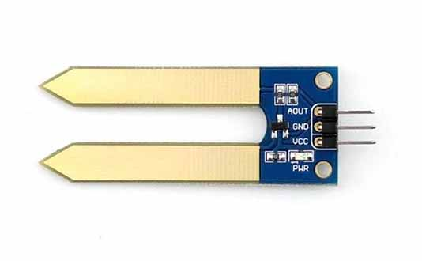
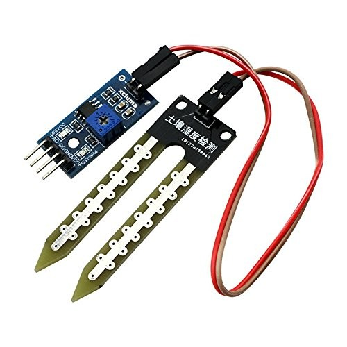
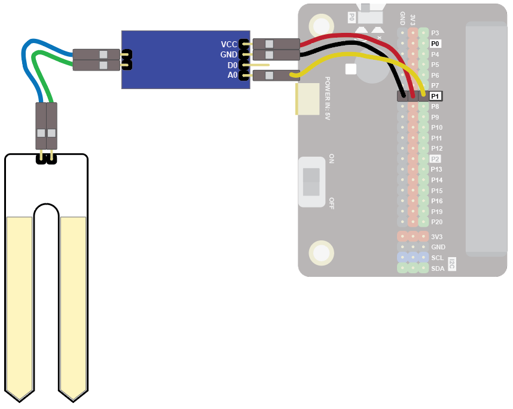
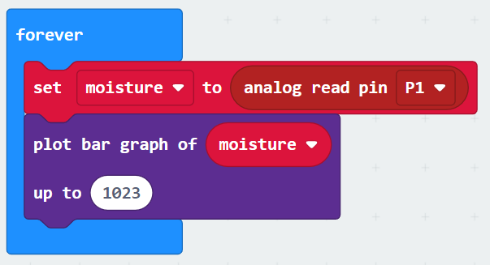

A soil moisture sensor provides an analogue input depending on the level of moisture detected.

Use it to measure moisture in soil or other materials.

Some sensors have just 3 pins attached to a single-part sensor:

Other sensors have 2 parts, with 4 pins on the little circuit board:

## Wiring
We will wire the sensor for analogue input.

Use FF cables to connect the sensor to the Edge Connector or Motor Controller board as follows:

|Soil Moisture Sensor | Microbit             |
| :------------------ | :------------------  |
|VCC                  | 3V3  |
|GND                  | GND  |
|AOUT or AO           | P1  |

Here the wiring is shown for the two-part sensor:

{ width=600 }

You don't have to use pin P1.  You can use any <a href="../../../assets/pins-short.png" target="_blank">analogue pin</a>.  Just remember to adjust your code accordingly.

Note that if you have a pin called D0 or DOUT, this can provide a digital reading instead.  The small blue potentiometer screw can be turned to calibrate the moisture level at which the digital signal turns on.

## Coding

Enter this code in **forever**:

[Download code to your computer](code/microbit-soil-moisture-bar-graph.hex)

Download the code to the microbit.

In the above code, the **map** block takes the moisture value, which is in the range 0 to 1023, and uses it to plot a bar chart on the LED display.  Move the sensor from dry to moist soil (or even a glass of water) and see the bar chart change.

 
