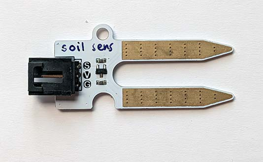
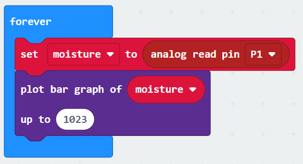

A soil moisture sensor provides an analogue input depending on the level of moisture detected.

Use it to measure moisture in soil or other materials.

## Wiring
Use a GVS cable to connect the sensor.  This has 3 wires, blue, red and black:

{ width=400 }

Wire up as follows, using the Edge Connector or Motor Controller board:

|Soil Moisture Sensor   | Microbit             |
| :-------------- | :------------------  |
|3-pin connector  | P0 3-pin connector   |

{ width=600 }

You don't have to use pin P0.  You can use any <a href="../../../assets/pins-short.png" target="_blank">analogue pin</a>.  Just remember to adjust your code accordingly.

## Coding

Enter this code in **forever**:

Download the code to the microbit.

In the above code, the **map** block takes the moisture value, which is in the range 0 to 1023, and uses it to plot a bar chart on the LED display.  Move the sensor from dry to moist soil (or even a glass of water) and see the bar chart change.

 
