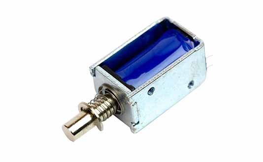
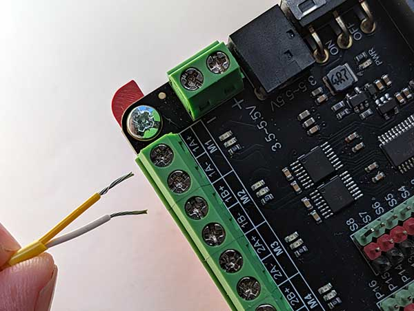
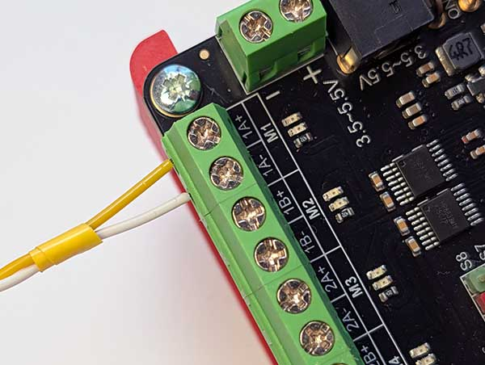
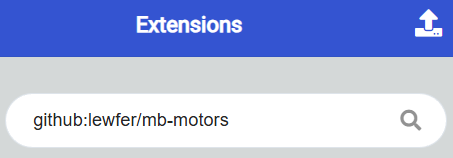
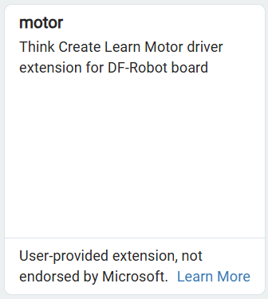
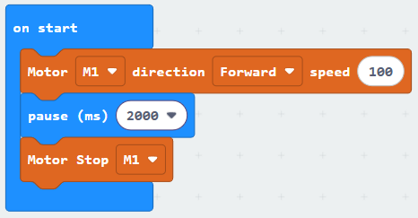

A solenoid is essentially an electromagnet that fires on demand.

Use it to hit things or lock doors.

## Wiring
Connect the loose wires to the Motor Controller.  To do so, unscrew the terminals for the required motor connection (M1, M2, M3 or M4), insert the wires, and then tighten the screws.

## Coding 
To use the motors you need to add the extension.

To add the extension, first click on Extensions:

Then enter the URL for the extension:

Then click on the extension:

You should see the following block:

Enter the following code:

Download the code to the microbit.

The solenoid should engage for 2 seconds and then disengage.

Note that solenoids can use a lot of power, so don't engage them for longer than you need.

