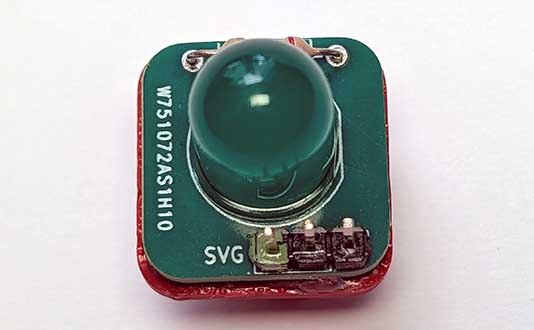
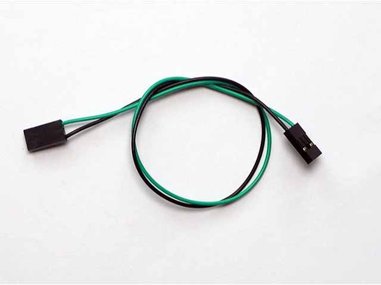
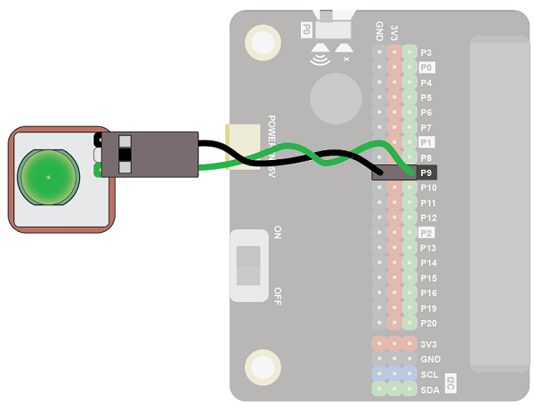
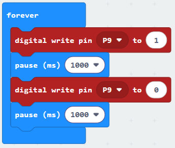
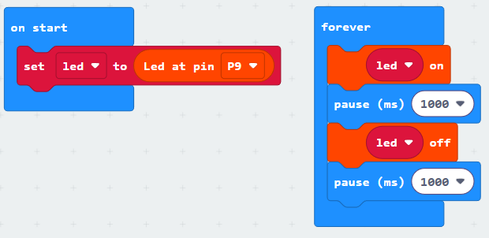
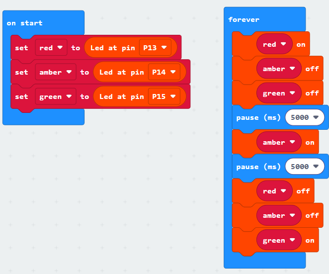
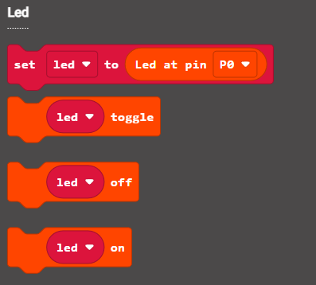

LEDs are small lights that come in a variety of sizes and colours. LED stands for Light Emitting Diode.

Diodes can only allow electricity to flow one way through them, so we need to make sure we connect them the right way around otherwise they won’t light up. 

## Wiring
Use a GS cable to connect the button.  This has 2 wires, green and black:

{ width=400 }

Wire up as follows, using the Edge Connector or Motor Controller board:

|LED   | Microbit             |
| :-------------- | :------------------  |
|3-pin connector  | P9 3-pin connector   |

{ width=600 }

You don't have to use pin P9.  You can use any <a href="../../../assets/pins-short.png" target="_blank">digital pin</a>.  Just remember to adjust your code accordingly.

## Coding

Enter this code:

Download the code to the microbit.

The LED should turn on and off every second (1000 milliseconds).

## Coding with the Bitmake extension
The bitmake extension makes it a bit easier to work with leds and other basic devices.

To add the extension, first click on Extensions:

Then enter the URL for the extension:

Then click on the extension:

You should see the following block:

Enter the following code:

Download the code to the microbit.

It will work in the same way as the previous code.  The benefit of using the extension is that controlling multiple leds is neater.  

For example, in the code below three leds are set up.  The led variables are given clear names: red, amber and green, which correspond to traffic lights.  It's easy to see which lights are turned on and off:

There are a number of code blocks in the Bitmake extension that can help you in your projects:

