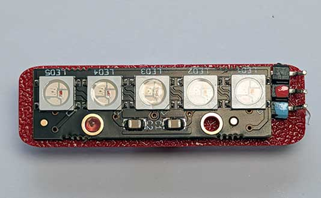
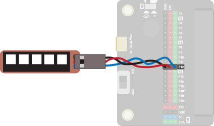
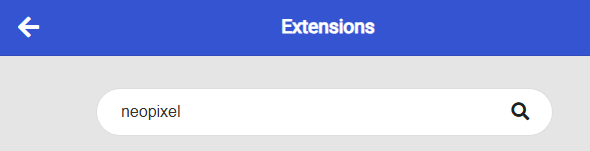
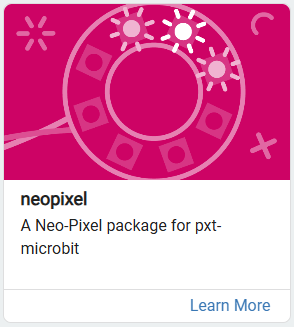
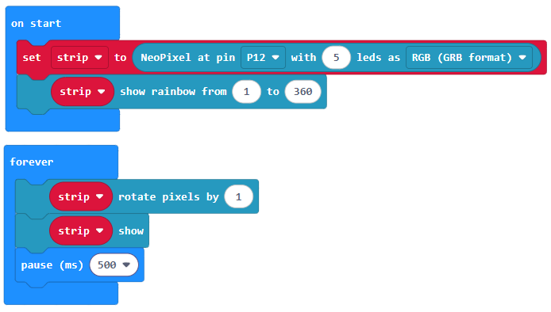
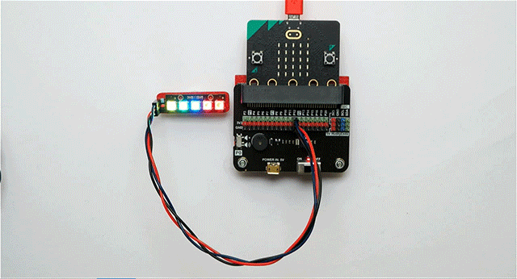

Neopixels come as strips of LEDs.  Each LED can be individually set to a different colour.

Use a neopixel to make a colourful light show, visualise some data and much more!

## Wiring
Use a GVS cable to connect the neopixel. This has 3 wires, blue, red and black:

Wire up as follows, using the Edge Connector or Motor Controller board:

|Neopixel          | Microbit             | 
| :--------------- | :------------------- | 
|3-pin connector   | P12 3-pin connector  | 

Make sure you connect the cable the right way round, with the black wire connecting to the black pin on both ends.

On the edge connector it should look like this:

You don't have to use pin P12.  You can use any <a href="../../../assets/pins-short.png" target="_blank">digital pin</a>.  Just remember to adjust your code accordingly.

## Coding

You will need to add an extension to get additional blocks for the neopixel.  Click on the extensions block:

Then search for "neopixel":

Then click on the **neopixel** extension:

You should see a new block appear:

Enter this code in **on start** and **forever** blocks:

Download the code to the microbit.

The on start block sets up a strip of 5 neopixels and shows a rainbow of colours on each one.  The forever block then rotates the pixels, so they move around the strip every 1/2 second.

{ width=600 }

The values in the show rainbow block relate to the range of colours, or **hue**, to show. You can use values from 0 to 360.  This relates to the HSL (Hue Saturation Lightness) model for defining colours.  Take a look at the link below.  Slide the H slider (H for Hue) from 0 to 360 to see the colours corresponding to each value.

[HSL Colours](https://www.w3schools.com/colors/colors_hsl.asp){target=_blank}

