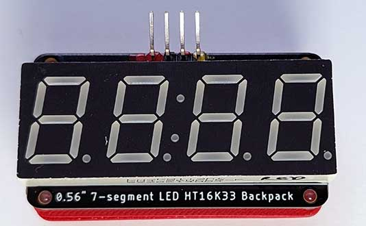
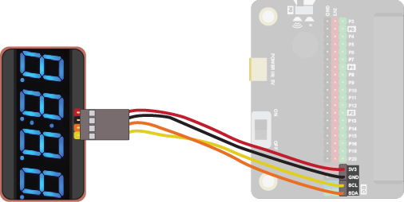
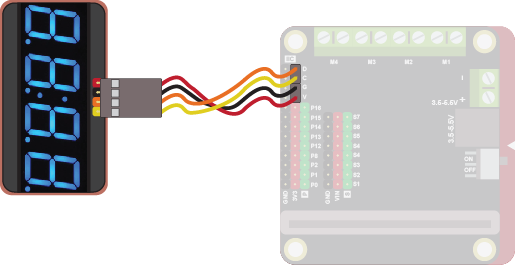
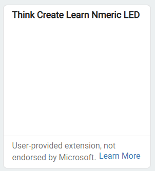
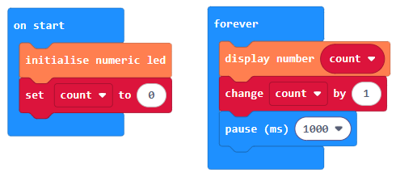
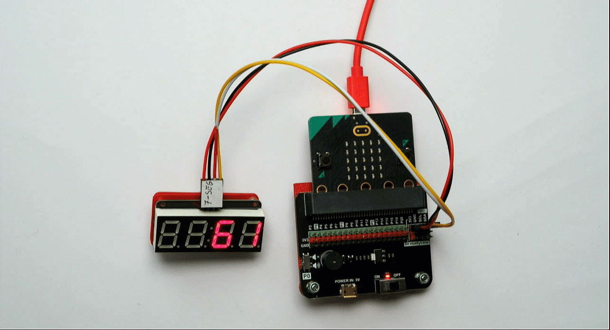

The numeric LED  can be used to display up to 4 numbers.

Use it to keep score, show the time and much more!

## Wiring
Use a special cable (7-seg) to connect the sensor.  This has 4 wires, white, yellow, red and black:

Wire up as follows, using the Edge Connector or Motor Controller board:

|Numeric Display   | Edge Connector | Motor Controller |
| :--------------- | :------------- | :--------------- |
|Red               | 3V3            | V                |
|Black             | GND            | G                |
|Yellow            | SCL            | C                |
|Orange            | SDA            | D                |

On the edge connector it should look like this:

On the motor controller it should look like this:

## Coding

You will need to add an extension to get additional blocks for the numeric LED.  Click on the extensions block:

Then search for **github:lewfer/mb-numeric-led**.  The following should appear:

Click on it.  You should see a new block appear:

Enter this code in **on start** and **forever** blocks:

Download the code to the microbit.

The code creates a simple counter, displaying the number of seconds that have elapsed since the start:

{ width=600 }

