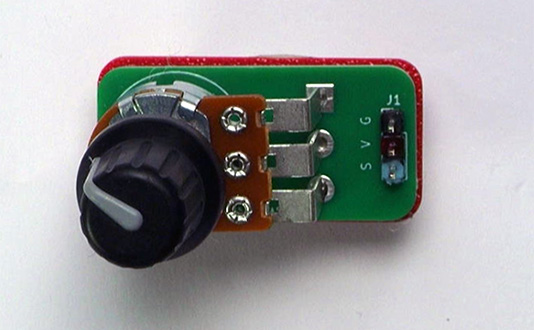
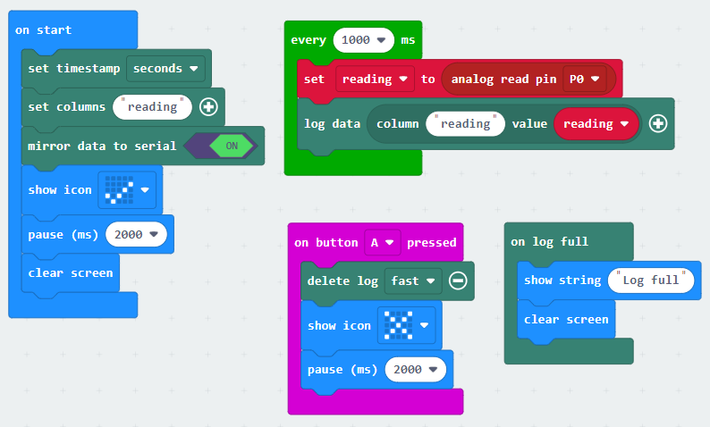
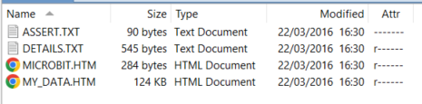
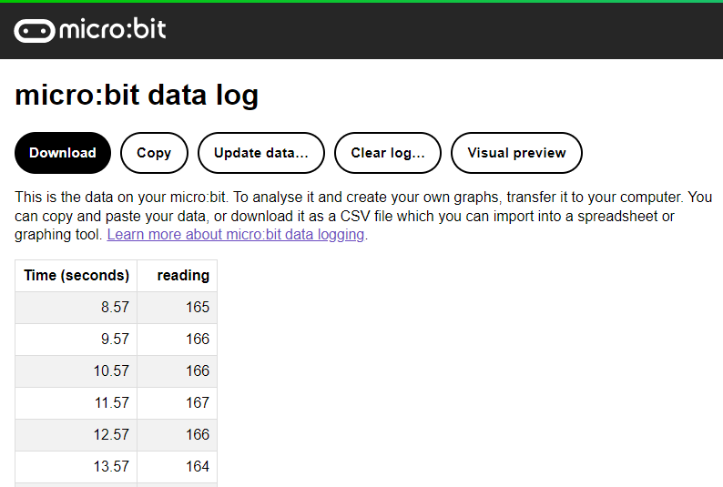

We can use our Microbit to capture data from sensors and store it.  This is handy for all sorts of simple data logging projects.

To see how this works, let's connect a potentiometer to the microbit using an edge connector.

You can replace the potentiometer with a sensor, such as a light sensor or weather sensor, but the wiring and coding to capture the data will be different.

## Wiring
Use a GVS cable to connect the sensor.  This has 3 wires, blue, red and black:

{ width=400 }

Wire up as follows, using the Edge Connector or Motor Controller board:

|Potentiometer   | Microbit             |
| :-------------- | :------------------  |
|3-pin connector  | P0 3-pin connector   |

{ width=600 }

You don't have to use pin P0.  You can use any <a href="../../../assets/pins-short.png" target="_blank">analogue pin</a>.  Just remember to adjust your code accordingly.

## Coding
We need to add the Data Logger extension.

To add the extension, first click on Extensions:

Find the following block and click on it:

Enter the following code:

Download the code to the microbit.

The Microbit will take readings from the potentiometer every second and store them.  Rotate the knob on the potentiometer so you get different readings.

You can press button A on the Microbit to clear the data and start again.

## View the data
After gathering the data for a couple of minutes, you can download the data.

On your computer, open up the microbit in File Explorer or Finder. Then double-click the MY_DATA.HTM file:

The data will be viewed in the browser:

Note that this can be really slow if the data is large.  In this case, drag the .htm file to your computer and edit it to extract the data you need into Excel or some other data tool.