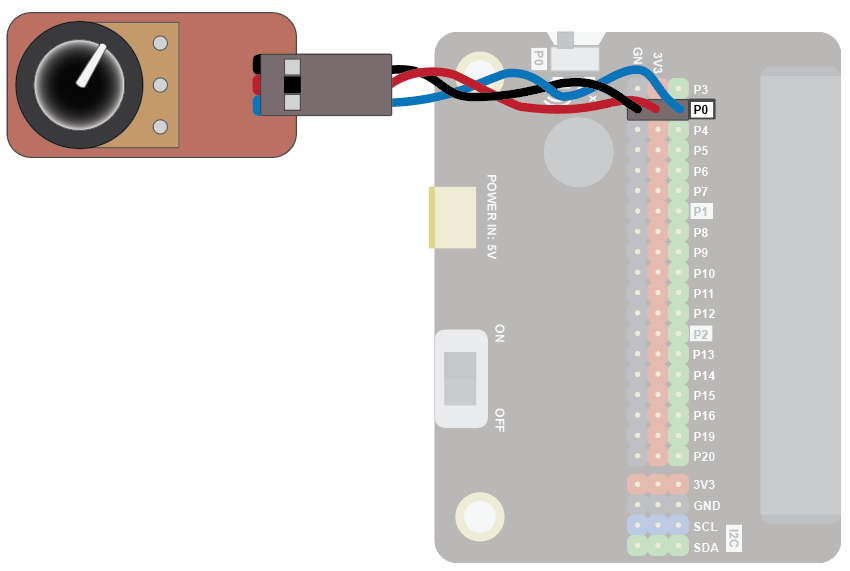
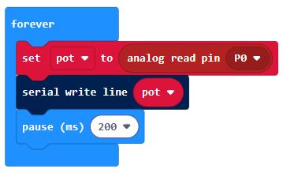
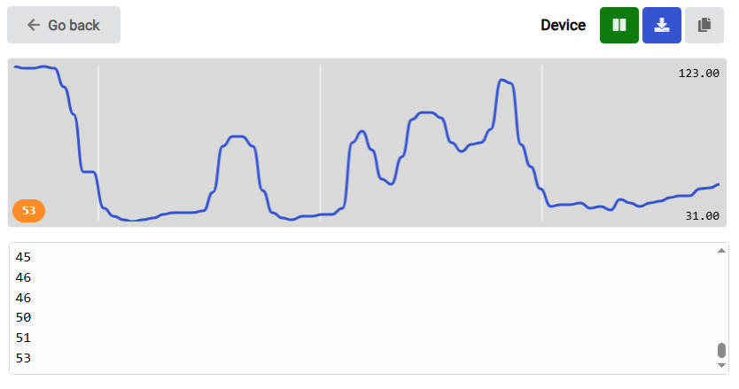

Sometimes code doesn’t work! To find the problem you need to do a bit of debugging. The microbit can write to data to your USB (serial) connection to the computer. You can then display the information that was sent on your computer.

You can also use the serial connection to see data, for example from sensors.

To see how this works, let's connect a potentiometer to the microbit using an edge connector.

You can replace the potentiometer with a sensor, such as a light sensor or weather sensor, but the wiring and coding to capture the data will be different.

## Wiring
Use a GVS cable to connect the sensor.  This has 3 wires, blue, red and black:

{ width=400 }

Wire up as follows, using the Edge Connector or Motor Controller board:

|Potentiometer   | Microbit             |
| :-------------- | :------------------  |
|3-pin connector  | P0 3-pin connector   |

{ width=600 }

You don't have to use pin P0.  You can use any <a href="../../../assets/pins-short.png" target="_blank">analogue pin</a>.  Just remember to adjust your code accordingly.

## Coding

Enter this code in **forever**:

The Serial blocks can be found in Advanced.

Download the code to the microbit.

To see the data, click on Show data Device:

You should see some numbers and a graph. These show the position of the potentiometer knob.  Rotate the knob and watch the values change:

Use the serial blocks in this way whenever you want to see data values from a sensor or want to debug your code.
